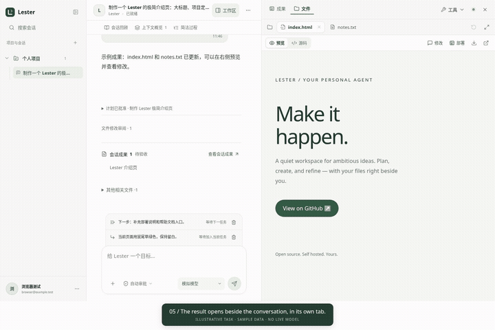

# Lester

**Make it happen.**

Lester 是一个开源、可自部署的 AI Agent 工作区。常驻的个人助理记住偏好、项目决策与工作脉络，把具体工作交给独立任务会话。任务 Agent 在你的专属 Computer 中处理文件、执行命令，产物可以直接预览并继续修改。

[English](README.md) · [文档目录](docs/zh-CN/README.md) · [快速开始](#快速启动) · [操作演示](#操作演示) · [GitHub](https://github.com/biubiuqiu/lester-agent) · [问题反馈](https://github.com/biubiuqiu/lester-agent/issues)

## Lester 能做什么

- **个人助理：** 独立的持续对话、私有记忆、任务创建与续接。
- **按项目工作：** 最近会话、项目背景、消息队列、提问与明确的任务权限。
- **直接查看成果：** 多标签文件、HTML/Markdown 预览、源码检查与静态站点发布。
- **选择模型与能力：** 多服务商模型、自定义 Agent、@ 引用、Skill 和附件。
- **离开页面也能安排工作：** 定时任务、入站 Webhook 与持久化任务记录。
- **使用自己的部署：** 六语言 Web，以及 iPhone、iPad 和 Android 客户端。

产品以对话驱动工作，不提供 Workflow/DAG 编辑器或多 Agent 编排界面。完整行为与支持边界见[使用指南](docs/zh-CN/usage.md)。

## 操作演示

[](docs/media/lester-walkthrough.mp4)

[观看 97 秒完整视频](docs/media/lester-walkthrough.mp4) · [视频章节与录制说明](docs/zh-CN/walkthrough.md)

演示使用受控示例数据，不代表真实模型调用或生成速度。录制早于个人助理面板，展示的是任务工作区；原“云端任务”入口现为“最近会话 → 任务状态”。

## 快速启动

需要 Docker、Docker Compose v2 和模型服务商凭证。以下命令从仓库根目录运行。

**仅限全新安装：**

```bash
cp deploy/.env.example deploy/.env
```

在 `deploy/.env` 中填写 `POSTGRES_PASSWORD`、`MASTER_KEY_BASE64`、`SANDBOX_SERVICE_TOKEN` 和 `MINIO_ROOT_PASSWORD`，分别生成独立的值：

```bash
openssl rand -hex 24       # POSTGRES_PASSWORD
openssl rand -base64 32    # MASTER_KEY_BASE64
openssl rand -hex 32       # SANDBOX_SERVICE_TOKEN
openssl rand -hex 24       # MINIO_ROOT_PASSWORD
```

```bash
docker compose --env-file deploy/.env -f deploy/docker-compose.yaml up -d --build
```

打开 [http://localhost:13000](http://localhost:13000)，进入工作区、注册账号，在“设置 → 模型”保存模型配置，然后发送第一个目标。固定的 **Lester** 入口打开独立个人助理。

[完整安装、PowerShell 与端口调整](docs/zh-CN/getting-started.md)。保存模型配置不代表已经验证服务商访问，实际调用由任务确认。

**已有部署：** 保留 `.env`、加密密钥和数据卷，备份后按编号执行尚未应用的全部迁移至 **032**，再启动匹配版本的服务。请先看[升级检查](docs/zh-CN/deployment.md#已有部署升级检查)，不要覆盖配置或删除数据卷。

连接 GitHub、Gmail、X、飞书和 Slack，让任务[按需搜索和读取资料](docs/zh-CN/app-connections.md)。

## 文档目录

从[中文文档总目录](docs/zh-CN/README.md)开始，也可以直接阅读章节：

| 章节 | 内容 |
| --- | --- |
| [快速开始](docs/zh-CN/getting-started.md) | 安装、配置与第一个任务 |
| [使用指南](docs/zh-CN/usage.md) | 个人助理、权限、队列、定时任务与会话回顾 |
| [项目与文件](docs/zh-CN/projects-and-files.md) | 成果、文件预览、阅读状态与站点发布 |
| [Agent 与上下文](docs/zh-CN/agents-and-context.md) | Agent、@ 引用、Skill 与附件 |
| [系统架构](docs/zh-CN/architecture.md) | 服务、Computer、持久化与上下文管理 |
| [部署与升级](docs/zh-CN/deployment.md) | 网关、Docker/ACS、Kubernetes/Helm 与升级 |
| [账号与安全](docs/zh-CN/accounts-and-security.md) | 单点登录、双令牌、头像、管理与安全配置 |
| [开发与 CI](docs/zh-CN/development.md) | 仓库结构、本地检查与 GitHub Actions |
| [移动客户端](docs/zh-CN/mobile.md) | iPhone、iPad 与 Android 的构建和安装入口 |

## 系统结构

Web 经网关访问 Go API；API 负责认证、任务执行、个人记忆与委派，Sandbox Service 管理每用户的 Computer。PostgreSQL 保存持久状态，Redis 投递实时事件，S3 兼容存储保存资源包与发布文件，独立 Artifact Host 提供公开快照。

详见[架构与隔离边界](docs/zh-CN/architecture.md)和[后端扩展说明](backend/ARCHITECTURE.md)。

## 部署

Docker Compose 提供本地部署；Kubernetes/Helm 可使用外部 PostgreSQL、Redis、S3 兼容存储，以及 Docker 或 ACS Computer。公开部署需要 HTTPS 和独立的成果域名。

上线前阅读[部署与升级](docs/zh-CN/deployment.md)、[安全配置](docs/zh-CN/accounts-and-security.md#安全提示)与 [Helm 参考](deploy/helm/lester/README.md)。
