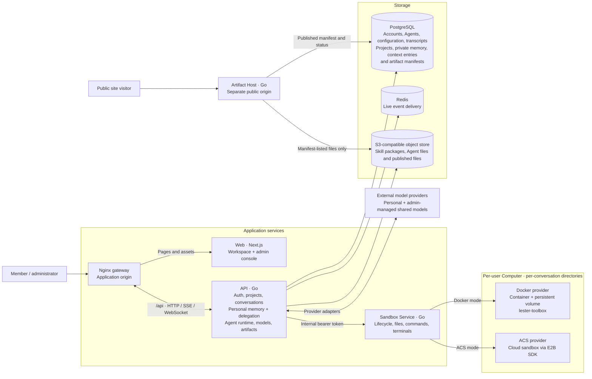
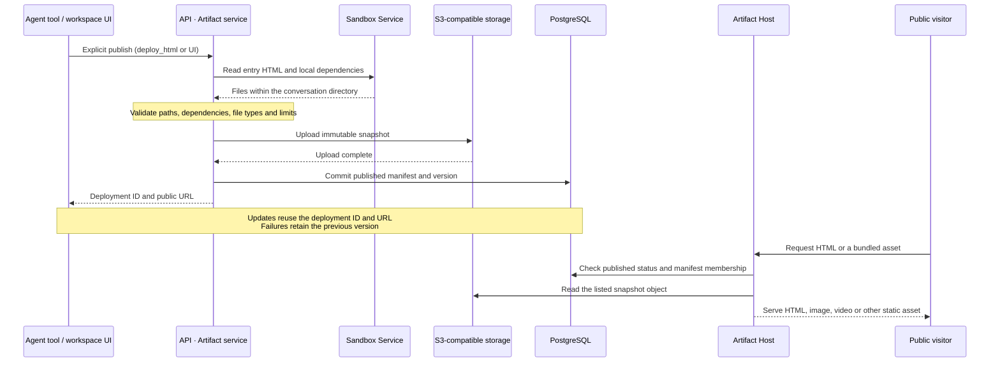

# Architecture and Computers

[Documentation](README.md) · [Project home](../README.md) · [简体中文](zh-CN/architecture.md)

Services, sandboxes, storage, events and model context.

> Commands run from the repository root unless stated otherwise. For existing databases, follow the [complete upgrade checklist](deployment.md#upgrading-an-existing-installation); feature-specific migration examples are partial steps.

## In this chapter

- [Architecture](#architecture)
- [Computers and sandboxes](#computers-and-sandboxes)
- [Conversation storage and context](#conversation-storage-and-context)

## Architecture

### System overview

The workspace and administration console share the application origin. Published HTML, images, and videos are served by an independent Artifact Host on a separate origin.



This diagram shows the Docker Compose entry point. Kubernetes uses Ingress to route to Web and API instead of the Nginx gateway. Browser API requests pass through the gateway directly; the Next.js service does not own the agent runtime or database access.

- **Conversation execution:** API authenticates the user, persists the conversation and run, calls the selected model provider, and executes tools through Sandbox Service. PostgreSQL holds durable history; Redis distributes live events that API streams to the browser.
- **Custom Agents:** The API stores workspace-scoped definitions and snapshots a chosen Agent into a new conversation. Its selected Skills install in the conversation Computer before execution. The separate creation assistant uses a model to suggest drafts without saving them.
- **Administration:** `/admin` uses role-protected API routes to manage accounts and shared models. Personal workspaces stay isolated, and provider credentials are encrypted at rest.
- **Public artifacts:** Artifact Host reads published snapshots and their manifests. It never serves live Computer files or receives model credentials or sandbox tokens.

### Connected apps and GitHub code

`internal/connector` owns encrypted, per-user app grants and fixed-host API adapters. Task tools resolve the accepted run submitter; the personal assistant only delegates. Ordinary app search/read never grants a Computer access token or write authority.

For separately authorized [GitHub code tasks](github-code-tasks.md), `internal/githubwork` coordinates pinned source reads, encrypted publication proposals and durable external-write receipts. Sandbox Service imports/exports files through the narrow native `GitHubTransfer` protocol; `internal/githubsandbox` validates the archive/selected paths and creates a credential-free local Git baseline. Docker and ACS directly invoke the fixed Toolbox without user login scripts. Ordinary editing/testing stays in the existing file/command tools. Publication passes the existing once-only user approval boundary and uses an expected-head GitHub commit; unknown receipts are reconciled without replaying writes. No new worker or generic connector command channel is added.

### Speech input

`internal/speech` is a separate input service inside API. An administrator enables one OpenAI-compatible transcription service or ElevenLabs Scribe and stores its encrypted credential. The authenticated Web/native recorder sends a bounded audio upload directly to this API; audio never enters a Computer, Skill or Agent tool. The returned text joins the latest scoped draft and requires the ordinary explicit send.

Stable request receipts precede the single provider call. Recovery reads the original receipt without retranscribing; text access expires after five minutes, and later transcription requests clear expired text and prune request IDs after 24 hours. Raw audio is not persisted by Lester; provider retention remains independent. Microphone access is restricted to the trusted app page, with explicit native permission handling and denied access for previews and published artifacts. See [configuration and limits](speech-input.md).

### Artifact publishing flow

Single-file HTML and multi-file sites use the same publishing service. Local images, videos, stylesheets, and scripts must be bundled from the conversation directory; missing dependencies or paths outside that boundary reject the deployment.



Web, API, Sandbox Service, and Artifact Host build and run separately. Sandbox Service owns Computer lifecycle, commands, files, and interactive terminals behind a common provider interface. Higher layers store an opaque `provider_ref` without depending on Docker container names or ACS Sandbox IDs.

Only Sandbox Service mounts the Docker socket in Docker mode and installs the static Go `lester-toolbox` helper into Computers. ACS uses the official OpenKruise Go E2B SDK without mounting the Docker socket. Private Sandbox Service endpoints require an internal bearer token; only its health check is unauthenticated. API accesses Skill packages through an object-store interface backed by S3-compatible MinIO in Compose.

| Service | Default host → container port | Purpose |
| --- | --- | --- |
| Nginx gateway | `13000 → 8080`, configurable | Single same-origin entry point |
| Web | Internal `3000` only | User interface |
| API | Internal `8080` only | Authentication, models, conversations, agent runtime |
| Artifact Host | `13181 → 8082`, configurable | Public, manifest-scoped static sites and media |
| Sandbox Service | Internal `8090` only | Computer lifecycle, commands, files, terminals |
| PostgreSQL | Internal `5432` only | Durable business data |
| Redis | Internal `6379` only | Live SSE distribution |
| MinIO | Internal `9000` / `9001` only | S3-compatible Skill package and artifact storage |

## Computers and sandboxes

Lester uses **one persistent Computer per user and one working directory per conversation**:

```text
User
└── Computer workspace mounted at /workspace
    └── conversations/
        ├── {conversationId-A}/
        ├── {conversationId-B}/
        └── {conversationId-C}/
```

Docker provides a per-user container and persistent volume; ACS provides a cloud Sandbox. Commands and terminals start in `/workspace/conversations/{conversationId}`, and file APIs enforce conversation boundaries. Paths are normalized and checked server-side. Docker's helper also validates resolved paths and symbolic links inside the container and provides atomic writes; ACS implements the same provider contract through runtime file APIs. File tools cannot access other conversation directories or arbitrary container paths such as `/tmp`.

The terminal connects to an interactive Bash PTY: Tab completes commands/paths, ↑/↓ recall history (or search a typed prefix), Ctrl+R searches history, Ctrl+C interrupts foreground commands, and Ctrl+L clears the display. Resizing reaches the PTY; bracketed multiline paste waits for Enter. Select text to copy with Ctrl+Shift+C / ⌘C or the toolbar; Shift+Esc leaves terminal focus. Mobile provides Tab, history, Escape, Ctrl+C and Ctrl+D buttons. Reconnecting starts a new Shell, not a restored running process. History persists per conversation in `.agent/terminal/bash_history`; begin sensitive commands with a space to omit them. History is local Computer data and should be included in your privacy/backup policy.

Custom images need Bash for this experience; otherwise the terminal falls back to `sh` with a visible notice. The supplied `backend/Dockerfile.sandbox-runtime` includes `bash-completion` for supported command arguments, `less` and terminal definitions. Rebuild that image and recreate the ACS template / new Computers to receive those image packages; updating Web and Sandbox Service enables Bash/readline support in existing Bash-equipped Computers without deleting their workspace.

Before use, API reconciles the provider's actual state, creates missing resources, resumes stopped/paused Computers, and prepares the conversation directory. Creation and recovery use a PostgreSQL per-user advisory transaction lock to prevent duplicate Computers across API replicas. Background reconciliation runs every 30 seconds by default; suspension follows 30 idle minutes.

Recreating a Docker container does not deliberately delete the user's volume. ACS preserves its workspace through pause/resume. Recovery from destroyed cloud Sandboxes, snapshots, and cross-provider migration are not provided.

### Runtime limits

| Setting | Default or limit |
| --- | --- |
| Docker sandbox image | `lester-sandbox-runtime:local` (built by Compose) |
| Docker network | `none` by default; administrator-selected network for new Computers only |
| Docker resources | 2 CPUs, 4 GB RAM, 256 PIDs, `no-new-privileges` |
| File operations | 25 MiB |
| Vision image read | 8 MiB per image |
| Foreground Bash timeout | 120 seconds; configurable up to 600 |
| Command stdout / stderr | Independently capped at 256 KiB |
| Model-visible tool result | Approximately 30,000 characters |

### Preinstalled development environment

Compose builds `backend/Dockerfile.sandbox-runtime` before starting Sandbox Service. New Computers use this image by default. It includes Node.js 22 with npm/pnpm, Python 3.12 with pip/venv, Go 1.26.9, Git, Bash completion, ripgrep, curl/wget, jq, SQLite, SSH client, editors, archive tools, FFmpeg, and C/C++ compilation tools. Node and Python Playwright **1.63.0** share predownloaded Chromium and its OS dependencies; CJK and emoji fonts are included. Python and Node scripts (including ESM) can import the preinstalled Playwright from conversation directories without downloading packages. The Node test runner is also available as `playwright test`.

The Agent's base prompt describes using Playwright through the existing command tool, with headless execution, page-result verification, browser cleanup and conversation-local screenshots/downloads. No browser Skill is required. Older Computers and custom images must be checked for actual availability. This provides script-based browser operation; it does not add a browser panel, dedicated browser-control tools or managed sessions, and does not enable external network access.

```bash
make sandbox-check
```

This builds the image and checks real Go/C compilation, Python virtual environments, and Node/Python Chromium screenshots as the non-root `sandbox` user with networking disabled. CI additionally checks named-volume write access, Toolbox installation, container recreation with retained files, and interactive terminal behavior. Legacy foreground command supervisors wait for the `setsid` session child, including when a runtime requires the launcher to fork; cancellation confirms owned-process cleanup before reporting success. CI exposes failing Docker integration cases as annotations. Docker Computers still have no external network by default: preinstalling tools does not enable package downloads or external website access. Project dependencies and other Playwright versions need their own packages/browsers and an appropriate deployment network policy.

For an existing `deploy/.env` using the previous default `SANDBOX_IMAGE=python:3.12-slim`, change it to `SANDBOX_IMAGE=lester-sandbox-runtime:local` and rebuild the Compose services. Intentional custom image tags remain supported. Existing Computers keep their running image; rebuilding services does not replace them or delete their data. An administrator must plan upgrades of existing Computers while retaining volumes and checking ownership (the new runtime uses UID/GID 1000; old root-owned workspaces may need an ownership migration). ACS needs the rebuilt image pushed and its template updated; Helm's Docker provider needs the image loaded on its dedicated worker or `sandbox.image` set to a pushed registry tag.

Restricted build environments may supply a prepopulated Playwright cache with BuildKit `--build-context browser-cache=/path/to/cache`; normal builds download the pinned browser automatically. The cache must contain binaries for the target architecture and the pinned Playwright revision. Optional `--secret id=proxy_ca,src=/path/to/combined-ca-bundle` supplies build-only TLS trust without persisting session certificates.

`bash` accepts `run_in_background: true`, returning a managed task ID, actual Shell/status and `.lester/tasks/{taskId}/output.log`. Use `task_output` for stable byte-offset output pages and `stop_task` for explicit task cancellation. Starting a background process does not prove it succeeded. The conversation's **Execution details → 命令任务** disclosure exposes logs, download and a separate Stop command action; stopping Agent generation does not stop background tasks.

Command truncation retains the beginning and end with omitted-byte counts. Text `read` streams a contiguous line range, returning one-based right-aligned line numbers, a tab, and original text, such as `"     1\tport: 8080"`. Use `offset`, `limit`, and `next_offset` to page; lines over 2,000 characters are explicitly truncated. Do not include added line-number prefixes in edits. Image reads return bounded `images[]` envelopes that integrations translate to native vision parts, not text containing base64.

ACS supports `native` and `private` routing. Native is the production default and requires wildcard DNS/TLS. Private uses a single domain with `/kruise` for internal/test access. Creation defaults to `secure` and `autoPause`; connection tokens are not stored in Lester's database.

## Conversation storage and context

PostgreSQL is the durable source of truth; Redis provides live delivery.

- `messages` stores user input, intermediate/final assistant messages, tool calls, and model-visible results, including truncation notices. `run_id` links execution and `tool_call_id` pairs calls/results. History restores by database-generated `messages.seq`, not timestamps or UUIDs.
- `runs` snapshots the triggering message, system prompt, tools, model ID, output settings, and initial history boundary (`history_through_seq`), excluding provider secrets.
- `run_events` drives activity displays without replacing the transcript. Each browser workspace keeps one authenticated SSE connection. Opening a conversation loads the latest 1,200 durable events; a persisted tab-local cursor and event-ID deduplication support refresh recovery.
- Stopping persists `running → cancelling → cancelled`, cancels streams and foreground tools, and emits `RUN_CANCELLED`. Unresolved tool calls receive cancelled/unknown results. Existing side effects are not rolled back.
- One run executes per conversation. Overlapping sends return HTTP 409 before inserting a message; different conversations can run concurrently. Each run holds an extra database session for its advisory lock: use direct connections or session pooling, not transaction pooling.
- After interruption, the next send marks abandoned runs failed and fills missing tool results with interrupted/unknown outcomes. Tools are never automatically replayed. Partial streams remain incomplete audit records outside complete model history.
- Default conversation responses show user/final assistant messages. Authenticated `GET /api/v1/conversations/{id}?include_internal=true` returns the full ordered transcript within normal workspace permissions.

### Tool-context working set

Before every model iteration, the runtime derives a read-only projection of complete history without rewriting stored messages or UI history.

| State | Default rule | Model input |
| --- | --- | --- |
| FULL | Latest 10 individual ToolExchanges and the entire latest unobserved batch | Original arguments and complete model-visible results |
| REFERENCE | Older reads, edits, writes, ordinary successful Bash calls, background tasks | Historical execution/file/range/command/exit-code/task-log references |
| EVICTED | Consumed low-value successes from an exact allowlist | Call/result pair omitted; assistant prose retained |

Calls and results are paired atomically, even in mixed batches. Failures are pinned as FULL until a verified matching success occurs in a later batch. Bash requires the same command and foreground/background mode; reads require the same path; other tools require equivalent JSON arguments. Conversational claims, same-batch successes, and background launches do not release failure pins.

Compound commands and redirected commands are not treated as allowlisted bare commands. `load_skill`, unknown tools, and unrecognized results stay FULL conservatively. References are marked historical data, not executable tool arguments. Pass `tool_execution_id` (`run_id:tool_call_id`) to `read_tool_result` to page the original stored result within the current conversation. This does not restore output shortened before storage or grant fresh file-write observations; use `task_output` for managed raw logs. Background references keep `task_id` and `log_path`. Re-reading files sees their current state; do not replay side effects to reconstruct output.

`MODEL_STARTED.payload.tool_context` reports policy version, FULL/REFERENCE/EVICTED/PIN counts, and before/after character counts, not exact token usage. `runs.context` stores the policy version and window size. This policy requires existing migration 004 but no extra migration. It does not add summaries, automatic compaction, Memory, RAG, or a total context budget; prose, references, and unresolved failures may still grow.

### Upgrading an existing database

PostgreSQL initialization mounts run only for fresh data directories. Back up existing databases, stop API writes, confirm migrations 001–003, and apply each missing migration once. This Bash example assumes 004 and 005 are both missing:

```bash
docker compose --env-file deploy/.env -f deploy/docker-compose.yaml stop api
docker compose --env-file deploy/.env -f deploy/docker-compose.yaml exec -T postgres \
  sh -c 'psql -v ON_ERROR_STOP=1 --single-transaction -U "$POSTGRES_USER" -d "$POSTGRES_DB"' \
  < backend/migrations/000004_durable_transcript.up.sql
docker compose --env-file deploy/.env -f deploy/docker-compose.yaml exec -T postgres \
  sh -c 'psql -v ON_ERROR_STOP=1 --single-transaction -U "$POSTGRES_USER" -d "$POSTGRES_DB"' \
  < backend/migrations/000005_user_profiles.up.sql
docker compose --env-file deploy/.env -f deploy/docker-compose.yaml up -d --build api
```

Fresh installs apply 004–005 automatically. Migration 004 preserves old chat order but cannot recover tool results older versions never stored; 005 adds built-in profile avatars. Rollback SQL retains message text, but older API versions do not understand new tool messages. Use a backup for a full downgrade.

### Deliverable registration and reliable events upgrade

The current version requires migrations 001–034. Migration 013 is described in [Accounts and sign-in](accounts-and-security.md#accounts-and-sign-in). The historical 004–005 commands above are insufficient for a full upgrade; apply every missing migration in numeric order. For a database already on 001–011, back it up, stop API writes, apply 012 once, then apply every remaining migration through 034 before rebuilding API/Web; see [the upgrade checklist](deployment.md#upgrading-an-existing-installation):

```bash
docker compose --env-file deploy/.env -f deploy/docker-compose.yaml stop api
docker compose --env-file deploy/.env -f deploy/docker-compose.yaml exec -T postgres \
  sh -c 'psql -v ON_ERROR_STOP=1 --single-transaction -U "$POSTGRES_USER" -d "$POSTGRES_DB"' \
  < backend/migrations/000012_deliverables_events.up.sql
```

New Compose volumes initialize migrations 001–034; existing volumes never upgrade automatically. Do not delete volumes. Rolling back 012 drops registered metadata and pending delivery intents while preserving Computer files, messages, run events, and published artifacts. Stop the updated API before rollback and restore a compatible application version. Monitor pending outbox count and disk space during prolonged Redis outages.

---

[← Agents, context and Skills](agents-and-context.md) · [Deployment and upgrades →](deployment.md)
