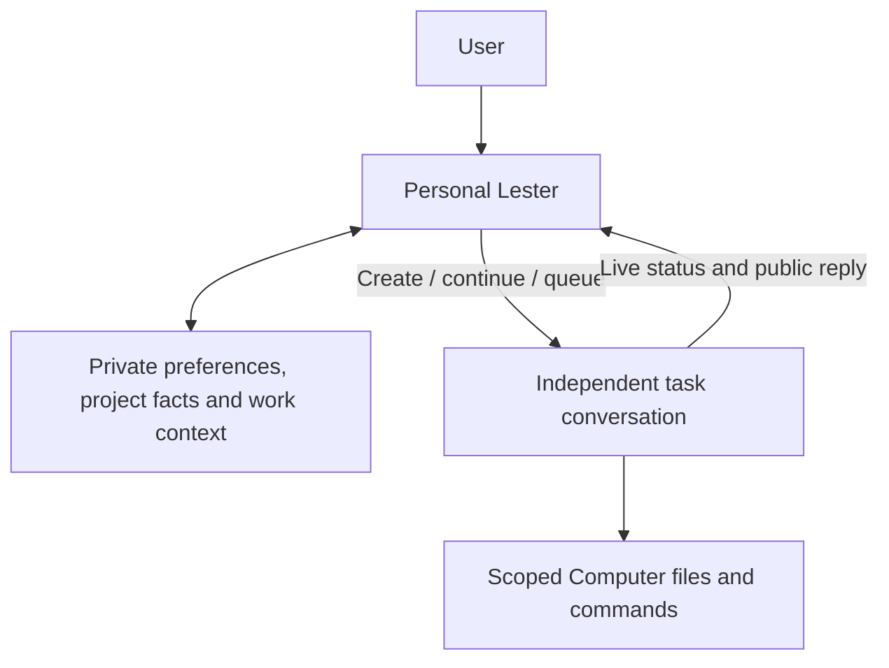

# Personal Lester: memory and coordination

The default `/app` entry is one persistent personal dialogue per user and workspace. There is no New chat action in this dialogue. `/app/new`, project task composers and existing `/app/c/{id}` conversations remain available for direct execution.

Personal Lester has no Computer, file, command, browser, Skill, approval, Stop or current-run adjustment tools. It uses the existing selected model in a tool-free call with JSON Schema, independently validates the result, and offers only a fixed set of memory/coordination actions. A model that rejects structured output fails explicitly; there is no silent plain-text/action fallback. Concrete work uses the existing Agent runtime, queue, project rules and operation approvals.

## Memory behavior

- **Personal preferences**: communication, design and working habits.
- **Project facts**: decisions and constraints, saved only when the user selects that project. They never enter another project's task.
- **Work context**: meaningful personal or project intentions. Current run status is always queried from platform records, not recalled as a fact.

Rows are private to the authenticated user/workspace; project scope does not turn them into shared project knowledge. Every model-generated fact must quote an exact substring of the latest user's message and points back to that personal turn. Task replies, inspected history and files are never automatically mined into memory. Existing task transcripts are not imported on upgrade.

Stable case-insensitive topics and IDs support correction instead of accumulating contradictory rows. The selected model sees a bounded topic directory and relevant facts, not every full transcript. Retrieval uses Latin words and Han bigrams, with personal preference/project-fact fallback; at most 24 facts / 10,000 fact characters are attached. The model's recent personal history is bounded to six completed turns and can be further projected for the configured context limit, always retaining the latest user input. This is explicit PostgreSQL memory, without vectors or a provider-owned memory store.

There are at most 128 active facts per user/workspace. A full memory store returns a visible unsaved-memory notice while the dialogue and task coordination continue. Forgetting frees active space. Tombstones remain to prevent automatic restoration of a forgotten topic; only a new explicit request can restore it.

Open **Memory** to search, inspect original quotes, edit, forget or undo. Automatic inference is optional and shows an undo receipt; explicit memory requests still work when it is off. Corrections, forgetting, undo and the inference setting advance a context barrier and revision. Earlier personal chat remains visible but is excluded from subsequent model history. A model response started before a memory change is rejected, preventing stale in-flight inference from restoring the removed fact.

Forgetting removes effective memory. Original chat, prior revisions needed for undo, and already accepted task snapshots remain; it does not claim server-wide erasure. Undo checks the exact resulting revision and cannot overwrite a newer correction or exceed active capacity.

## Task handoff

Initially the model sees bounded, owned task metadata with project names and current run state. It can perform one read-only title/project search or inspect the bounded public transcript of one offered, owned conversation. It cannot enumerate other users' work or inspect tool internals/files. Ambiguous targets require clarification.

New task IDs and submission IDs are persisted before dispatch. New delegated tasks use Lester and **standard permissions**. Existing conversations retain their Agent, model and current project. Active runs receive the existing ordered next-task queue input. The personal assistant cannot insert into, stop, approve or raise the permissions of an existing run.

The server selects only relevant personal/same-project memory, labels it reference data and stores it in the accepted task prompt. Ordinary project-rule snapshots still apply. The shared immediate/queued acceptance transaction checks that the conversation still belongs to the prepared project; concurrent moves cannot transfer the old project's facts. Editing or forgetting memory later does not retroactively alter accepted task inputs.

Pending questions/approvals appear as Needs your attention and link back to the original conversation. Cards show the current project and live state through the existing workspace SSE; public replies are bounded previews. Completion means Agent execution ended, not independently verified results. Open the original task for files, approvals and full execution detail. No native background/lock-screen push is added.

## Persistence, failure and APIs

`personal_threads`, `personal_turns`, `personal_memories`, `personal_memory_changes` and `personal_delegations` are PostgreSQL authority. A dedicated session advisory guard serializes personal turns without holding a pooled connection during model waits. Request UUIDs and exact digests prevent duplicate model calls. Live account/session/membership and thread revision are checked again before accepting a response, using user → session → thread lock ordering.

Incomplete owners become interrupted after their session guard is released. Missing responses and uncertain delegation use the original run/input receipt only; no automatic model retry, tool replay, replacement conversation or background worker is introduced. Request timeouts are bounded, errors do not contain provider credentials, and personal-model usage observations are retained on the turn.

All endpoints require the ordinary session and mutation-Origin checks:

| Endpoint | Behavior |
| --- | --- |
| `GET /api/v1/personal?before={seq}` | Up to 30 chronological turns, memory and current owned tasks |
| `POST /api/v1/personal/messages` | `{id, content, model_id, project_id}`; one scoped durable turn |
| `GET /api/v1/personal/messages/{id}` | Original turn/receipt; recovery never dispatches |
| `GET /api/v1/personal/tasks` | Bounded current task cards |
| `PATCH /api/v1/personal/settings` | `{auto_memory}` |
| `PATCH /api/v1/personal/memories/{id}` | `{revision, content, forget}` |
| `POST /api/v1/personal/changes/{id}/undo` | Revision-checked, idempotent undo |

Personal drafts and pending receipt IDs use the existing account-scoped browser draft store. Closing/reopening preserves text; logout clears it and blocks late writes. Native iOS/Android Home opens the same Web dialogue; there is no separate native memory/runtime.

## Upgrade and validation

Back up and stop API writes/active tasks, apply every missing migration through `000031_personal_assistant.up.sql`, then rebuild API and Web together. Fresh Compose mounts 001–031. Helm operators apply SQL externally. Do not delete volumes or replace encryption keys. Rollback 031 deletes personal dialogue, memories and delegation records, preserving task conversations, files and external effects.

PostgreSQL tests cover provenance, corrections, undo, deletion barriers, capacity, user/project isolation, revocation, abandoned owners, idempotency, real task/queue acceptance and rollback. Tests use a two-connection pool to catch nested acceptance starvation. Production-browser fixtures cover desktop/mobile dialogue, drafts, lost responses, memory management, task cards, short screens and six-language help. Fixture output is not a live provider or native-device validation.

中文使用说明位于当前部署的 `/docs/usage#personal-assistant`，完整正文支持中文、英文、日文、韩文、法文和西班牙文。个人助理只负责记忆和调度，具体工作仍在独立任务会话中执行。
