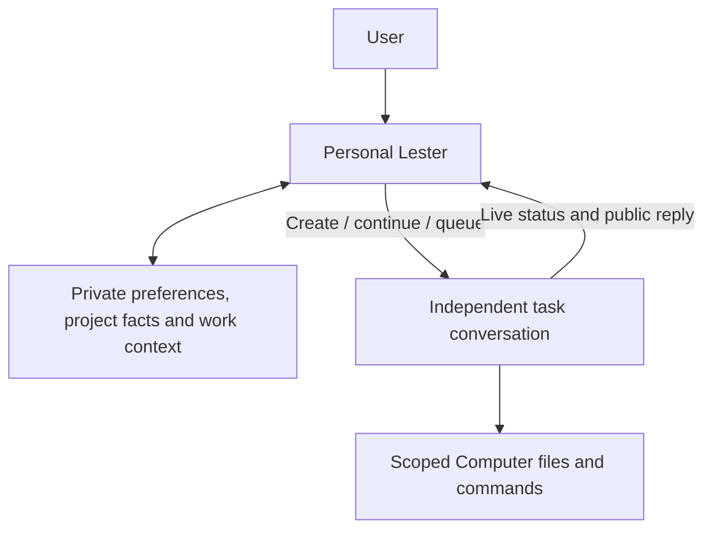

# Personal Lester: memory and coordination

The fixed **Lester** entry (bottom right on wide screens, in navigation on narrow screens) opens an independent, persistent assistant panel throughout authenticated `/app` routes, including settings. It is owned by the app layout: navigation and minimizing preserve its transcript, draft and in-flight request. Wide displays reserve space for a non-modal companion so the task composer stays usable; an open Computer pane retains its existing space. Constrained displays use a viewport-aware modal panel with native focus trapping, with a full sheet on phones. Opening a task from the sheet minimizes it. `/app` and `/app/new` are task composers; project composers and existing `/app/c/{id}` conversations retain execution. Model/project choices live in assistant settings, outside its composer.

Personal Lester has no Computer, file, command, browser, Skill, approval, Stop or current-run adjustment tools. It uses the existing selected model in a tool-free call with JSON Schema, independently validates the result, and offers only a fixed set of memory/coordination actions. For tool-free personal calls only, an OpenAI-compatible provider explicitly rejecting `json_schema` with HTTP 400/422 can negotiate `json_object` once, with the full schema in the system instructions. The same strict server-side parser, evidence checks and action validation still apply. Authentication, rate limits, invalid schemas, malformed output and uncertain transport failures never negotiate or replay. Approval requests remain strict JSON Schema. There is no plain-text/action fallback. Concrete work uses the existing Agent runtime, queue, project rules and operation approvals.

## Memory behavior

- **Personal preferences**: communication, design and working habits.
- **Project facts**: decisions and constraints, saved only when the user selects that project. They never enter another project's task.
- **Work context**: meaningful personal or project intentions. Current run status is always queried from platform records, not recalled as a fact.

Rows are private to the authenticated user/workspace; project scope does not turn them into shared project knowledge. Every model-generated fact must quote an exact substring of the latest user's message and points back to that personal turn. Task replies, inspected history and files are never automatically mined into memory. Existing task transcripts are not imported on upgrade.

Stable topics and IDs support correction instead of accumulating contradictory rows. Topic comparisons and word matching normalize Unicode, case and whitespace; CJK matching remains bounded. The selected model initially sees a scoped topic directory and up to 24 relevant facts / 10,000 fact characters, not every full transcript. If more detail is needed, it can select up to 12 active memory IDs from that directory for one read-only recall, capped at 10,000 fact characters. This shares the one-read allowance with task search, unread lookup and transcript inspection; it does not add executable tools or permission changes. Only unpaused personal and selected-project facts are eligible; paused records are omitted from the directory, initial facts, lookup and future delegated inputs. Directory topics can be abbreviated and marked as truncated; saved memory text is unchanged. The complete request budget may reduce the initial fact selection further.

The model's recent personal history is bounded to six completed turns from personal scope and the selected project; another project's older turns are excluded even though the full dialogue remains visible. History can be further projected for the configured context limit, always retaining the latest user input. This is PostgreSQL memory with deterministic matching, not embedding-based semantic search or a provider-owned memory store.

There are at most 128 saved, non-forgotten facts per user/workspace, including paused records. A full memory store returns a visible unsaved-memory notice while the dialogue and task coordination continue. Forgetting frees active space. Tombstones remain to prevent automatic restoration of a forgotten topic; only a new explicit request can restore it.

### Add and manage memories

Open **Settings → Memory** (`/app/settings/memory`), or **Memory** in the assistant. Both entries use one persistent manager, so moving between them keeps the current editor and search state. Choose **Add memory** to save a topic, content, category and personal/project scope directly. This does not call a model or start a task and works before configuring an assistant model. Personal preferences have personal scope; project facts require a project; work context can be personal or project-specific. Project scope remains private to you, rather than shared with other project members.

Search and filter the list, inspect each memory's source and change history, then edit its topic, content, category or scope, pause or resume it, forget it, or undo a confirmed change. A manually added record is identified as your direct input; a model-extracted record retains its original user-message quote. Manual edits are labeled honestly rather than attributed to a fabricated chat turn. Changing scope affects future recall and delegation only.

Saves check the current revision and topic uniqueness, including forgotten-topic reservations. A conflicting update cannot overwrite a newer correction. The editor preserves the draft so you can inspect the latest state first. Memory-editor drafts survive closing the dialog and moving between its settings and assistant entries within the mounted app; they are not persisted across a reload. If a save response is lost, **Check status** only reads the original record; the client never automatically repeats a create, edit, availability change, forget or undo. Matching current text alone is not proof that the original request succeeded. You can explicitly keep the observed current memory; this accepts that state without manufacturing a successful save receipt or undo action. **Return to editing** preserves the draft and original creation UUID and clears only the local pending state. It does not undo an already accepted server operation; a later save is an explicit request.

Pausing retains the record, source and history and lets you keep editing it, while excluding it from future personal-model requests, read-only lookup and delegated memory snapshots. It continues to count toward the 128-record limit. Only a user action can resume it; a model cannot overwrite or resume a paused record. Availability changes check the current revision, like edits. Already accepted task inputs keep their original snapshots.

History shows recorded before/after states and undo relationships, newest first, with 30 changes per page. Undo checks the current resulting revision and appends its own change; it cannot overwrite later edits. Older undo operations may leave historical gaps, which are not reconstructed as if they had been recorded. History is read-only; use the current last-change undo receipt to reverse a confirmed change.

An assistant reply can show the memories supplied as reference for that reply, identified by ID and revision. This records bounded request context after budgeting; it does not prove the model used or followed a fact. Task handoff continues to use the accepted task snapshot rather than this reply receipt.

Automatic inference is optional and shows an undo receipt; explicit memory requests still work when it is off. Creation, corrections, pausing/resuming, forgetting, undo and the inference setting advance a context barrier and revision. Earlier personal chat remains visible but is excluded from subsequent model history. Every provider call, including a second call after read-only lookup, rechecks the live account/session and captured context revision. A model response started before a memory change is rejected, preventing stale in-flight inference from restoring the removed fact. Already transmitted requests cannot be retracted.

Forgetting removes effective memory. Original chat, prior revisions needed for undo, and already accepted task snapshots remain; it does not claim server-wide erasure. Undo checks the exact resulting revision and cannot overwrite a newer correction or exceed active capacity.

## Task handoff

You can say **“Create a new task in the Product project to prepare a review checklist”** or ask Lester to continue a previous conversation. An explicit request starts the ordinary task handoff; it does not require opening the task composer first. Welcome shortcuts only add a suggested request to the current draft. Review and send it explicitly.

Initially the model sees bounded, owned task metadata with project names, current run state and unread-reply information. It can perform one read-only memory recall, title/project search, unread-reply lookup or inspect the bounded public transcript of one offered, owned conversation. It cannot enumerate other users' work or inspect tool internals/files. Ambiguous targets require clarification.

New task IDs and submission IDs are persisted before dispatch. New delegated tasks use Lester and **standard permissions**. Existing conversations retain their Agent, model and current project. Active runs receive the existing ordered next-task queue input. The personal assistant cannot insert into, stop, approve or raise the permissions of an existing run.

For an explicit assistant handoff, the server selects only relevant unpaused personal/same-project memory, labels it reference data and stores it in the accepted task prompt. Task inputs follow the task's workspace access rules, so a delegated snapshot is not a private-memory storage boundary. Ordinary task composers do not automatically receive personal memory. Ordinary project-rule snapshots still apply. The shared immediate/queued acceptance transaction checks that the conversation still belongs to the prepared project; concurrent moves cannot transfer the old project's facts. Editing, pausing or forgetting memory later does not retroactively alter accepted task inputs.

Pending questions/approvals appear as Needs your attention and link back to the original conversation. Cards show the current project and live state through the existing workspace SSE; public replies are bounded previews. Completion means Agent execution ended, not independently verified results. Open the original task for files, approvals and full execution detail. No native background/lock-screen push is added.

## Unread replies

Ask **“Which conversations have new replies I haven’t read?”**, or open **Unread replies** in the assistant. The list shows each conversation’s title, project and reply time. It queries all your conversations in the current workspace, independently of the recent-task limit, with 30 conversations per page and a total count. Loading more and retrying a failed read only fetch the list; they never create or restart a task. The model’s lookup respects a selected project when one is set.

Unread means a saved, nonempty public assistant reply newer than your confirmed read position. Tool calls, internal process, partial streams and other users’ conversations do not count. Current task status and a new reply are separate: an unfinished task can already have a public reply.

Opening the assistant, asking for unread replies or expanding a reply preview does not mark a task read. A confirmed read position advances only when the end of a saved reply is visible in the focused, foreground task conversation. Hidden tabs and replies below the current scroll position remain unread. The API verifies the displayed message and stores a monotonic position per account, workspace and conversation, so an older acknowledgement cannot hide a newer reply. Read positions persist across devices; open clients refresh after confirmed acknowledgements and the existing workspace events, without another execution stream or background worker.

Tracking begins with migration 036. Existing replies become an upgrade baseline because Lester has no trustworthy earlier read history; it does not claim to reconstruct which old replies you had seen. New saved replies after that baseline participate in unread tracking.

## Persistence, failure and APIs

`personal_memories` holds authoritative current facts and provenance; `personal_memory_changes` holds the change journal. Bounded model working context, personal dialogue, task history and accepted delegation snapshots remain separate records. `personal_threads`, `personal_turns`, `personal_delegations` and `conversation_read_states` also use PostgreSQL authority. A dedicated session advisory guard serializes personal turns without holding a pooled connection during model waits. Request UUIDs and exact digests prevent duplicate model calls. Live account/session/membership and thread revision are checked again before accepting a response, using user → session → thread lock ordering.

Incomplete owners become interrupted after their session guard is released. Missing responses and uncertain delegation use the original run/input receipt only; no automatic model retry, tool replay, replacement conversation or background worker is introduced. Request timeouts are bounded, errors do not contain provider credentials, and personal-model usage observations are retained on the turn.

All endpoints require the ordinary session and mutation-Origin checks:

| Endpoint | Behavior |
| --- | --- |
| `GET /api/v1/personal?before={seq}` | Up to 30 chronological turns, memory, current owned tasks and first unread page |
| `POST /api/v1/personal/messages` | `{id, content, model_id, project_id}`; one scoped durable turn |
| `GET /api/v1/personal/messages/{id}` | Original turn/receipt; recovery never dispatches. `memory_context` identifies the supplied reference memories by ID/revision/topic/project, deduplicated to at most 36 entries |
| `GET /api/v1/personal/tasks` | Bounded current task cards and first unread page |
| `GET /api/v1/personal/unread?cursor={cursor}&project_id={id}` | Read-only unread conversations, total and next cursor; optional project scope |
| `POST /api/v1/conversations/{id}/read` | `{message_id}`; confirm an owned public reply and monotonically advance its read position |
| `PATCH /api/v1/personal/settings` | `{auto_memory}` |
| `GET /api/v1/personal/memories` | Independent, identity-bound manager read returning `{user_id, workspace_id, memories, auto_memory}`; saved records include `paused`, default `false` |
| `PUT /api/v1/personal/memories/{client_uuid}` | `{topic, content, kind, project_id}`; direct creation without a model, returning `{memory, change_id}` |
| `GET /api/v1/personal/memories/{id}` | Current owned record, including a forgotten record's `deleted` state; a read never repeats a mutation |
| `PATCH /api/v1/personal/memories/{id}` | `{revision, content, forget?, details?: {topic, kind, project_id}}`; supply the whole `details` object when changing metadata |
| `PATCH /api/v1/personal/memories/{id}/availability` | `{revision, paused}`; returns `{memory, change_id}` |
| `GET /api/v1/personal/memories/{id}/history?before_revision={revision}` | `{memory, changes, has_more}`; up to 30 changes in descending revision order. Use the last returned revision as the next cursor |
| `POST /api/v1/personal/changes/{id}/undo` | Revision-checked, idempotent undo that journals the restored state |

Each history change contains `{id, memory_id, revision, before, after, undone, turn_id, created_at, undo_of?}`. Creation has `before: null`; manual changes have no invented source turn. New undo changes point to their original change through `undo_of`. Older history gaps are left visible rather than backfilled.

Direct creation uses a client-preallocated UUID. The same UUID and original payload return the current memory and original creation change ID, even if the memory was later edited or forgotten; a different original payload conflicts. A duplicate topic under another ID also conflicts. A current-record GET cannot by itself prove that a particular save payload was accepted.

Personal drafts and pending receipt IDs use the existing account-scoped browser draft store. Closing/reopening preserves text and refreshes saved dialogue/memories through a read, including recovery after a failed initial read. Reopening never resends a message or delegation. Memory searches distinguish an empty result, and short viewports scroll the editor without squeezing it beneath the fixed controls. Logout clears drafts and blocks late writes. Native iOS/Android Home opens the task composer; the same Web assistant launcher is available throughout the app. There is no separate native memory/runtime.

## Upgrade and validation

Migration 038 (`000038_memory_management.up.sql`) adds per-record `paused` availability (default `false`) and undo relationships in the existing change journal. It does not ingest historical task or file bodies, create an embedding/vector service, or add a background consolidation worker. Rebuild API and Web together; older deployments must apply every missing migration.

Back up and stop API writes/active tasks, apply every missing migration through `000038_memory_management.up.sql`, then rebuild API and Web together. Fresh Compose mounts 001–038. Helm operators apply SQL externally. Do not delete volumes or replace encryption keys. Rollback 038 preserves memories, changes and tasks, but refuses while any non-forgotten record remains paused: explicitly resume those records before downgrading to avoid silently restoring them to model context. Use a compatible API/Web version. Migration 036 establishes read tracking and the existing-history baseline; its rollback removes read positions and the supporting index, preserving conversations, messages, tasks and memories. Rollback 031 deletes personal dialogue, memories and delegation records, preserving task conversations, files and external effects.

PostgreSQL tests cover provenance, corrections, undo, deletion barriers, capacity, user/project isolation, revocation, abandoned owners, idempotency, real task/queue acceptance, unread pagination, verified read positions and rollback. Tests use a two-connection pool to catch nested acceptance starvation. Production-browser fixtures cover desktop/mobile dialogue, drafts, lost responses, memory management, task cards, short screens and six-language help. Fixture output is not a live provider or native-device validation.

[简体中文](zh-CN/personal-assistant.md) · The deployed `/docs/usage#personal-assistant` guide is available in Chinese, English, Japanese, Korean, French and Spanish. Personal Lester coordinates work; independent task conversations perform it.

Implementation rationale and pinned public references: [Agent memory design research](research/agent-memory-design.md).
