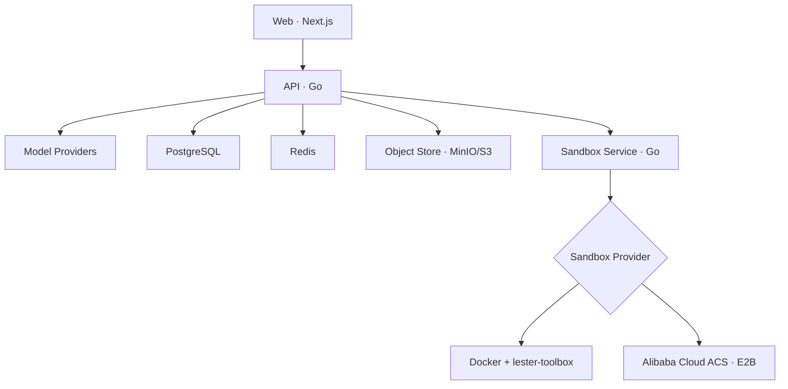

# 架构与 Computer

[文档目录](README.md) · [项目首页](../../README.zh-CN.md) · [English](../architecture.md)

服务边界、沙箱、存储、事件与模型上下文。

> 除非代码块另有说明，命令均从仓库根目录运行。已有数据库先看[完整升级检查](deployment.md#已有部署升级检查)，功能章节中的迁移示例只是部分步骤。

## 本章目录

- [系统结构](#系统结构)
- [服务与端口](#服务与端口)
- [沙箱机制](#沙箱机制)
- [上下文存储](#上下文存储)

## 系统结构



Web、API 和 Sandbox Service 分别构建和运行在独立容器中。Sandbox Service 通过统一 Provider 接口负责 Computer 生命周期、命令、文件和交互式终端；上层只保存不透明的 `provider_ref`，不感知 Docker 容器名或 ACS Sandbox ID。Docker 模式由 Sandbox Service 独占挂载 Docker Socket，并把静态 Go 二进制 `lester-toolbox` 安装到 Computer；ACS 模式使用 OpenKruise 官方 Go E2B SDK，不挂载 Docker Socket。私有接口要求 API 使用内部 Bearer Token，只有健康检查无需认证。Skill 安装包由 API 通过对象存储接口访问，当前 Compose 使用兼容 S3 API 的 MinIO。

### 应用连接与 GitHub 代码任务

`internal/connector` 管理按用户加密保存的应用授权和固定服务商 API。任务工具使用本次已接受任务的提交者身份；个人助理仅委派任务。普通应用搜索、读取不会把访问令牌或写权限交给 Computer。

另行授权的 [GitHub 代码任务](github-code-tasks.md)由 `internal/githubwork` 协调固定版本源码、加密发布快照和持久外部写入回执。Sandbox Service 通过专用原生 `GitHubTransfer` 协议导入、导出文件；`internal/githubsandbox` 检查归档与所选路径，建立无凭证的本地 Git 基线。Docker 与 ACS 都直接执行固定 Toolbox，不运行用户登录脚本。编辑和测试仍走现有文件、命令工具；发布走现有单次用户审批与 expected-head GitHub 提交，未知回执只核对、不重放写入。不增加独立 Worker 或通用连接器命令通道。

### 个人助理与未读回复

`internal/personal` 通过现有会话接收链路创建任务、续接旧任务。无工具的个人助理模型只获得有界的任务与未读元数据，实际工作仍在独立任务会话中执行。PostgreSQL 的 `conversation_read_states` 保存每个读者最后确认的公开回复序号；未读列表查询全部本人会话，不受最近任务数量限制，查询本身不会清除未读。聚焦且位于前台的任务页面按实际显示的回复末尾提交消息 ID，旧确认不会吞掉随后到达的新回复。036 迁移为已有历史建立跟踪基线。详见[个人助理、记忆与未读回复](personal-assistant.md)。

### 语音输入

`internal/speech` 是 API 内独立的输入服务。管理员选择一个转写服务，密钥加密保存在服务端。OpenAI 兼容协议包含 Groq 与 Together AI 预设；ElevenLabs Scribe、Deepgram Nova 与 Mistral Voxtral 使用独立适配器。Web 与原生薄客户端录制的有界音频直接发送到此 API，不进入 Computer、Skill 或 Agent 工具；返回文字加入当前用户的最新草稿，仍需明确发送。

服务商调用前先保存稳定请求回执，恢复时只读原记录、不重复转写。文字恢复窗口为五分钟，后续转写请求清理过期文字，并删除超过 24 小时的请求身份。Lester 不持久保存录音，服务商保留政策独立。麦克风限定在可信应用页面，原生端还需显式系统权限；预览和公开产物禁止获取麦克风。配置与限制见[语音输入](speech-input.md)。

## 服务与端口

| 服务 | 本地端口 → 容器端口 | 用途 |
| --- | ---: | --- |
| Nginx Gateway | `13000 → 8080`（可配置） | 唯一默认入口，页面与 API 同源 |
| Web | 仅 Compose 内网 `3000` | 用户界面 |
| API | 仅 Compose 内网 `8080` | 登录、模型配置、对话和 Agent Runtime |
| Artifact Host | `13181 → 8082`（可配置） | 独立域名上的公开站点与静态资源 |
| Sandbox Service | 仅 Compose 内网 `8090` | Computer 生命周期、命令、文件和终端 |
| PostgreSQL | 仅 Compose 内网 `5432` | 持久化业务数据 |
| Redis | 仅 Compose 内网 `6379` | SSE 事件分发 |
| MinIO | 仅 Compose 内网 `9000` / `9001` | Skill 安装包对象存储（S3 兼容） |

## 沙箱机制

Lester 采用“**每个用户一个持久化 Computer，每个会话一个独立目录**”的模型。这样既不会随着会话数量增加而创建大量容器，又能保持会话之间的文件边界。

```text
User
└── Computer workspace mounted at /workspace
    └── conversations/
        ├── {conversationId-A}/
        ├── {conversationId-B}/
        └── {conversationId-C}/
```

### 隔离边界

- 一个用户只对应一个逻辑 Computer；Docker 下对应一个容器和持久化 Volume，ACS 下对应一个云端 Sandbox。
- 每个会话固定使用 `/workspace/conversations/{conversationId}` 作为工作目录。
- Agent 的 `bash`、`read`、`write`、`edit` 工具，以及右侧 Files 和 Terminal，都由服务端强制限定在当前会话目录。
- 文件路径在服务端进行规范化和越界检查；其他会话目录和 `/tmp` 等容器路径不能通过文件工具访问。
- Docker 的 `lester-toolbox` 会在容器内部再次验证真实路径和符号链接边界，并提供原子写入；ACS 通过官方运行时文件 API 实现同一 Provider 契约。两者都保留 25 MiB、目录项数、行长度和命令输出限制。
- `computer_list_files` 不作为 Agent 工具暴露；Agent 使用 `bash` 配合 `ls`、`find` 或 `rg --files` 查找文件。

### 生命周期与故障恢复

每次使用 Computer 前，API 都会通过 Sandbox Service 核对 Provider 的真实状态，而不是只相信数据库中的状态：

1. Computer 不存在时创建 Provider 资源；ACS 返回的动态 Sandbox ID 会立即写入 `provider_ref`。
2. Computer 已停止或暂停时，自动恢复运行。
3. Computer 状态异常时执行 Provider 对应的恢复流程。
4. Computer 正常后，自动创建当前会话目录并将命令、文件和终端操作切换到该目录。
5. 后台监控默认每 30 秒同步一次 Provider 状态；默认空闲 30 分钟后暂停，下次使用时自动恢复。

创建和恢复使用 PostgreSQL 用户级 advisory transaction lock，多个 API 副本不会为同一用户并发创建多个 Computer。Docker 删除或重建容器不会主动删除用户 Volume；ACS 使用暂停/唤醒保存工作区，但当前不提供快照、跨 Provider 迁移或被销毁后的自动文件恢复。

### 资源与后台任务

默认 Docker Sandbox 使用 Compose 自动构建的 `lester-sandbox-runtime:local`。镜像预装 Node.js 22（npm / pnpm）、Python 3.12（pip / venv）、Go 1.26.10、Git、Bash 补全、ripgrep、curl / wget、jq、SQLite、SSH 客户端、编辑器、压缩工具、FFmpeg 和 C/C++ 编译工具。Node.js 与 Python 的 Playwright **1.63.0** 共用预下载的 Chromium 与系统依赖，包含中日韩字体和 Emoji 字体；在会话目录中可直接导入 Playwright，Node 的 ESM 和 CommonJS 都可用，也可运行 `playwright test`。

运行 `make sandbox-check` 可构建镜像，并在非 root 的 `sandbox` 用户、禁用网络、2 CPU / 4 GB / 256 PID / `no-new-privileges` 条件下实际验证 Go/C 编译、Python 虚拟环境与两种语言的 Chromium 截图。CI 还检查命名卷写入、Toolbox 安装、保留文件的容器重建和交互式终端。预装工具不会开启外网；项目的新依赖、其他版本的 Playwright 及外部网站访问仍需要相应依赖和部署网络配置。

Docker 默认使用 `none` 网络。管理员可用 `SANDBOX_DOCKER_NETWORK` 为新 Computer 指定已有的专用网络或 `bridge`，并另行配置出网策略；它本身不提供域名白名单、防火墙或代理。拒绝 host 和容器网络命名空间，不自动替换已有 Computer。ACS 仍使用其模板与租户网络策略。

已有 `deploy/.env` 如果沿用旧默认 `SANDBOX_IMAGE=python:3.12-slim`，请改为 `SANDBOX_IMAGE=lester-sandbox-runtime:local` 后重建 Compose 服务；有意使用的自定义镜像仍可保留。重建镜像不会替换已有 Computer，也不会删除工作区。现有 Computer 的升级需由管理员保留卷并安排迁移，新镜像使用 UID/GID 1000，旧 root 所有的目录可能需要迁移文件权限。ACS 需推送新镜像并更新模板；Helm 的 Docker 模式需在专用节点加载镜像，或将 `sandbox.image` 指向已推送的仓库镜像。

构建网络受限时，可用 BuildKit 的 `--build-context browser-cache=/path/to/cache` 提供与目标架构、Playwright 固定版本匹配的浏览器缓存；普通构建自动下载。可选 `--secret id=proxy_ca,src=/path/to/combined-ca-bundle` 只在构建时提供 TLS 信任，不把会话证书写入镜像。

ACS Provider 支持 `native` 与 `private` 两种 E2B 路由。生产默认使用 Native（需要泛域名 DNS/TLS）；Private 使用单域名 `/kruise` 路径，适合内网接入和测试。创建默认启用 `secure` 与 `autoPause`，运行时访问令牌由每次 connect 获取且不会写入 Lester 数据库。

`bash` 支持 `run_in_background: true`，返回受管理的任务 ID、实际 Shell/状态和 `.lester/tasks/{taskId}/output.log`。Agent 使用 `task_output` 按字节分页读取日志，使用 `stop_task` 独立停止命令。对话中的“命令任务”提供日志、下载和停止命令入口；停止 Agent 生成不会停止后台任务。前台 Bash 默认超时 120 秒，最大可配置为 600 秒。

`bash` 的 stdout/stderr 会在 Sandbox Provider 边界分别限制为 256 KiB，并保留开头与结尾及明确的省略字节数；返回模型前仍会应用约 30,000 字符的工具结果限制。`read` 使用流式按行读取，只返回所需范围，不会为了读取几行而把整个大文件载入内存。`load_skill` 同样受单次结果限制。

`read` 返回带行号的文本，格式为“右对齐的行号 + Tab + 原始内容”，行号从 1 开始。例如 JSON 中的 `"     1\tport: 8080"`。读取范围仍使用 `offset` / `limit`；达到行数或字符限制时返回连续的一页与 `next_offset`，不会把开头和结尾拼成一段。单行超过 2000 字符会明确标记截断，需使用更精确的命令检查剩余部分。编辑时不要把行号和分隔 Tab 写入文件，原有缩进则需保留。常见图片扩展名会以受限的 base64 `images[]` 附件返回：Anthropic-compatible 模型使用原生 image block，OpenAI-compatible 模型使用配套的 vision image part，不会把 base64 当普通文本发送；单张图片上限 8 MiB。

## 上下文存储

- `messages` 保存用户输入、中间/最终助手消息、`tool_calls` 和 `tool` 结果；`run_id` 关联执行，`tool_call_id` 配对调用与结果。完整保存的是工具实际返回给模型的内容（包括截断提示），不是未截断的所有文件或命令输出。
- 每个会话按数据库生成的递增 `seq` 恢复历史，不再依赖时间戳或随机 UUID 排序。
- `runs` 记录触发消息，以及当次 System Prompt、工具定义、模型 ID、输出参数和历史起点快照信息（`history_through_seq` 为初始历史的末尾序号），不保存 Provider 密钥。
- `run_events` 继续供界面展示执行过程。工具开始/完成/失败事件携带调用 ID，完成/失败事件包含工具结果；它们不替代消息历史。
- 浏览器只保持一条 Workspace 级 SSE，后台会话通过 `conversation_id` 更新左侧运行摘要；打开会话时单独拉取最近 1,200 条持久化事件。浏览器在 `sessionStorage` 保存 Workspace 事件游标，刷新后只补缺失事件，前端始终按事件 ID 幂等合并。
- 用户停止任务时，Run 会从 `running` 持久化进入 `cancelling`，执行进程取消模型流和前台工具后落为 `cancelled` 并产生 `RUN_CANCELLED`。已经开始但没有结果的工具调用会补一条“已取消、结果未知”的工具结果，避免破坏后续模型上下文；已发生的外部副作用不会自动回滚。页面刷新可从 PostgreSQL 恢复正在运行或正在停止的 Run；Redis/SSE 只负责实时通知。
- 同一会话一次只执行一个 Run；重复发送返回 HTTP 409，且不会提前插入消息。不同会话仍可并行。每个运行使用一个额外的数据库会话持有锁，因此数据库需直连或使用 session pooling，不能使用 transaction pooling。
- 进程中断后，下一次发送会将无主运行标记为失败，为尚未返回结果的工具补充“执行中断、结果未知”的记录，不会自动重跑工具。已发生的文件修改不会自动撤销。部分模型流会保留为不完整审计记录，但不作为完整消息传给后续模型。
- 默认会话查询仍只展示用户消息和最终回答；`GET /api/v1/conversations/{id}?include_internal=true` 可查看完整有序记录（需正常登录与 Workspace 权限）。

### 工具上下文工作集

工具执行记录不等于模型上下文。每一轮模型请求（包括同一个 Run 内的工具循环）都会从完整有序历史生成只读投影，不修改数据库记录或 UI 历史：

| 状态 | 默认规则 | 发给模型的内容 |
| --- | --- | --- |
| FULL | 最近 10 个 ToolExchange；尚未被模型看到的最新工具批次也全部保护 | 原始调用参数 + 完整的模型可见结果 |
| REFERENCE | 窗口外的 read、edit、write、普通成功 bash 或后台任务 | 紧凑历史记录，包含执行引用、文件/实际读取范围、命令/退出码或任务日志路径；不再发送原始大参数和结果 |
| EVICTED | 模型已消费的低价值成功结果，如 list_files、白名单中的裸 pwd/ls/git status | 调用和结果一起省略，原 assistant 正文仍保留 |

- 按单次调用计数，不按消息或批次计数。同一 assistant 消息里的多个工具可以分别降级，但保留的调用和结果必须配对。REFERENCE 在原 assistant 位置呈现为带标记的历史数据，不伪造可执行工具参数。
- `error`、`is_error`、`ok:false`、非零 `exit_code` 或失败/中断状态会额外 PIN 为 FULL。只有后续批次中可验证的同操作成功才解除：bash 要求相同命令且前后台模式相同（忽略超时/描述），read 要求相同文件路径；其他工具要求等价 JSON 参数。不同命令、后台任务刚启动、同批次成功或对话中的“已经修好”不会自动解除。
- 低价值判断使用精确命令白名单，不会把 `pwd && go test`、带重定向的 `ls` 或搜索结果误删。当前搜索通过 bash 执行，窗口外保留命令与退出码引用，不猜测命中文件。`load_skill`、未知工具和无法识别的结果保守保持 FULL。
- 引用里的 `tool_execution_id` 由 `run_id:tool_call_id` 组成，可传给 `read_tool_result`，按 Unicode 字符分页读取当前会话已保存的原始结果。它不会恢复入库前已截掉的内容，也不授予新的文件修改观察；受管理命令的原文日志使用 `task_output`。重新 read 得到的是当前文件状态，不保证等于历史快照；不要为了恢复输出盲目重跑可能有副作用的 bash 命令。后台任务引用保留 `task_id` / `log_path`。
- `MODEL_STARTED.payload.tool_context` 记录策略版本、FULL/REFERENCE/EVICTED/PIN 数量和裁剪前后正文/参数字符数；这是字符统计，不是精确 token 用量。`runs.context` 保存策略版本和默认窗口大小。

这层管理与单次工具输出限制同时生效，无需新增数据库迁移（仍需已有的 004）。暂不包含对话摘要、自动压缩、Memory、RAG 或总 token 预算；普通对话、历史引用及未解决错误仍可能增长。首次接入已有会话时也会应用这套策略。

### 已有部署升级

已有 PostgreSQL Volume 不会重新执行 Docker 的初始化 SQL。先备份数据库、停止 API 写入，并确认已应用迁移 001–003，再执行一次：

```bash
docker compose --env-file deploy/.env -f deploy/docker-compose.yaml stop api
docker compose --env-file deploy/.env -f deploy/docker-compose.yaml exec -T postgres \
  sh -c 'psql -v ON_ERROR_STOP=1 --single-transaction -U "$POSTGRES_USER" -d "$POSTGRES_DB"' \
  < backend/migrations/000004_durable_transcript.up.sql
docker compose --env-file deploy/.env -f deploy/docker-compose.yaml exec -T postgres \
  sh -c 'psql -v ON_ERROR_STOP=1 --single-transaction -U "$POSTGRES_USER" -d "$POSTGRES_DB"' \
  < backend/migrations/000005_user_profiles.up.sql
docker compose --env-file deploy/.env -f deploy/docker-compose.yaml up -d --build api
```

全新部署会自动执行 004–005。004 保留旧聊天记录的原有排序，但不能补回旧版本从未保存的工具结果；005 为用户资料增加内置头像主题。回滚 SQL 保留消息文本，不过旧 API 不理解新增工具消息；完整应用降级应使用备份恢复。

### 成果登记与可靠事件升级

当前版本需要迁移 001–036；账号机制的 013 迁移见下方“账号、第三方登录与头像”。上面的 004–005 命令仅说明历史聊天升级，不足以升级到当前版本；请按编号补齐所有尚未执行的迁移。若数据库已完成 001–011，先备份、停止 API 写入，再执行一次 012，并继续补齐 013、014、015 后重建 API/Web：

```bash
docker compose --env-file deploy/.env -f deploy/docker-compose.yaml stop api
docker compose --env-file deploy/.env -f deploy/docker-compose.yaml exec -T postgres \
  sh -c 'psql -v ON_ERROR_STOP=1 --single-transaction -U "$POSTGRES_USER" -d "$POSTGRES_DB"' \
  < backend/migrations/000012_deliverables_events.up.sql
```

全新 Compose 数据卷会按序执行 001–036；已有数据卷不会自动升级，勿删除数据卷。012 回滚会删除成果登记和待投递记录，保留原文件、消息、运行事件及已发布站点；回滚前停止新版 API，并配套恢复兼容的应用版本。Redis 长期不可用时待投递表会增长，需要监控数量和磁盘空间。

---

[← Agent、上下文与 Skill](agents-and-context.md) · [部署与升级 →](deployment.md)
