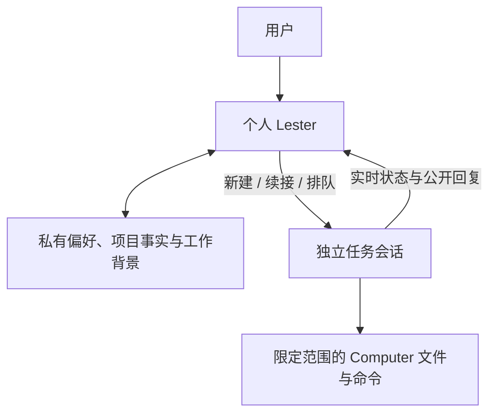

# 个人 Lester：记忆与工作安排

[文档目录](README.md) · [使用指南](usage.md) · [English](../personal-assistant.md)

固定的 **Lester** 入口（宽屏右下角、窄屏导航栏）在已登录的 `/app` 页面打开独立、常驻的个人助理，包括设置页面。面板由应用布局持有；切换页面或收起面板会保留对话、草稿和进行中的请求。宽屏使用非模态侧面板，给任务输入框保留操作空间；已打开的 Computer 面板沿用原有空间。窄屏使用适应可见视口的模态面板和原生焦点约束，手机上显示为完整抽屉；打开任务后会收起助理。`/app`、`/app/new` 和项目页面的输入框负责具体任务，已有 `/app/c/{id}` 会话仍使用原执行机制。模型与项目选择位于助理设置中。

个人助理没有 Computer，也没有文件、命令、浏览器、Skill、审批、停止或运行中补充工具。它使用已配置模型进行无工具、带 JSON Schema 的调用，服务端独立校验结果，只支持固定的记忆和工作安排操作。仅此类无工具调用，在 OpenAI 兼容服务明确以 HTTP 400/422 拒绝 `json_schema` 时，可协商一次 `json_object`，并在系统说明中保留完整 Schema。原有严格解析、依据与操作校验仍生效。认证、限流、无效 Schema、格式错误或结果未知的传输失败不会触发协商或重放；审批调用仍使用严格 JSON Schema。没有纯文本操作回退。具体工作继续使用现有 Agent 运行时、队列、项目规则和操作审批。

## 记忆行为

- **个人偏好：** 沟通、设计与工作习惯。
- **项目事实：** 只在选中项目后保存的决策与限制，不进入其他项目的任务。
- **工作背景：** 有意义的个人或项目意图。运行状态始终查询平台当前记录，不当作长期事实记忆。

记忆属于当前用户和工作区；选中项目不会把它变成共享项目知识。模型生成的每条事实必须引用最新用户消息中的原文，并指向来源个人对话。任务回复、检查过的历史和文件不会被自动提炼为记忆，升级时也不会导入已有任务全文。

稳定的主题和 ID 用于更正已有事实，主题比较与词语匹配会规范化 Unicode、大小写和空白，CJK 匹配也有明确边界。模型首先看到当前范围的主题目录和最多 24 条、10,000 个事实字符。需要细节时，可按目录中的 ID 只读召回最多 12 条有效记忆，正文合计不超过 10,000 字符；它与任务搜索、未读查询、公开历史检查共用每轮一次的只读检索额度，不增加可执行工具或操作权限。范围限于未暂停的个人和当前选定项目记忆；暂停记录不进入目录、首次事实、只读召回或之后的委派快照。目录中的长主题可能缩略并标明截断，已保存的记忆正文不变；完整请求预算也可能进一步减少首次附带的事实数量。

最近个人对话最多包含个人范围和当前选定项目的六轮完整回复；其他项目的旧对话不进入模型上下文，完整聊天仍可查看。必要时继续按模型上下文限制裁剪，但保留最新用户输入。记忆明确存于 PostgreSQL，使用确定性的词语匹配，不是基于 embedding 的语义检索，也不使用服务商持有的记忆。

每个用户与工作区最多保存 128 条未忘记的事实，暂停记录仍占容量。空间已满会显示未保存记忆的提示，对话和工作安排仍可继续。忘记后可释放有效容量；删除标记保留，避免自动恢复已经忘记的主题，只有新的明确请求才能重新保存。

### 新增与管理记忆

打开 **设置 → 记忆**（`/app/settings/memory`），或助理中的 **记忆**。两处共用一个常驻管理器，切换入口会保留编辑与搜索状态。选择 **新增记忆**，填写主题、内容、类别与个人/项目范围即可直接保存，无需配置模型，不调用模型，也不创建任务。个人偏好使用个人范围；项目事实必须选择项目；工作脉络可属于个人或项目。项目范围仍只供本人使用，不会变成项目成员共享知识。

列表支持搜索和筛选。可查看每条记忆的来源和修改历史，修改主题、内容、类别与范围，暂停或恢复使用、忘记记忆，或撤销已确认的修改。手工新增会标明来自本人直接输入；模型提炼保留原始用户消息依据；手工编辑会如实标注，不伪造聊天来源。范围调整只影响之后的召回与委派。

保存会检查当前版本和主题唯一性，已忘记主题的保留标记同样参与冲突检查。过期编辑不能覆盖较新的更正，草稿会保留，可先查看最新状态。记忆编辑草稿在关闭对话框，以及应用内切换设置和助理入口后仍保留，不承诺刷新页面后恢复。保存响应丢失时，**检查状态**只读取原记录，不会自动重复新增、编辑、暂停/恢复、忘记或撤销；当前内容恰好相同，也不单独作为原请求成功的证明。可以明确选择保留读取到的当前记忆，这只接受当前状态，不伪造成功保存回执或撤销入口。**返回编辑**会保留草稿与原新增 UUID，只清除本地待确认状态，不会撤销服务端已经接受的操作；之后再次保存仍需明确点击。

暂停会保留记忆、来源和历史，仍可继续编辑，但不进入之后的个人模型请求、只读召回或委派快照，仍占 128 条容量。只有用户操作才能恢复使用，模型不能覆盖或恢复暂停项。暂停和恢复与编辑一样检查当前版本，已经接受的任务输入保留原快照。

修改历史按新到旧显示已记录的修改前后状态和撤销关系，每页 30 条。撤销检查当前结果版本，并追加一条自己的变更记录，不能覆盖后续修改。旧撤销可能留下历史缺口，不会伪造当时未记录的变更。历史只读；撤销使用当前最近一次已确认变更的回执入口，不从旧版本直接恢复。

助理回复可展开查看本次提供作参考的记忆，按 ID 与版本标识。它记录预算裁剪后实际放入请求的有界资料，不证明模型采纳或遵循了该事实。任务委派仍以已经接受的任务快照为准，与此回复回执分开。

自动提炼可以关闭，并会显示可撤销的回执；关闭后仍可明确要求记住信息。新增、更正、暂停/恢复、忘记、撤销和自动提炼设置都会推进上下文边界与版本：之前的个人聊天仍可查看，但不再进入后续模型历史。每次模型请求（包括只读检索后的第二次调用）都会重新检查账号、登录会话与捕获的上下文版本；记忆变更前已开始的旧模型回复会被拒绝，避免恢复已删除的事实。已发送给服务商的请求无法收回。

忘记会移除有效记忆，原始聊天、撤销所需历史版本和已接受任务中的记忆快照仍保留，不代表从所有存储中抹除。撤销检查精确版本，不能覆盖更新的更正，也不能突破有效记忆容量。

## 新建与续接任务

可以直接说：**“在产品项目新建一个任务，整理评审清单。”** 也可以让 Lester 继续之前的会话。明确请求会进入普通任务委派链路，不必先打开任务输入框。欢迎页的快捷入口只向当前草稿添加建议，请核对后明确发送。

模型起初只看到有界、属于自己的任务元数据，包括项目名称、当前运行状态和未读回复信息。它可以进行一次只读记忆召回、标题或项目搜索、未读查询，或者检查一个已提供、属于自己的会话中有界的公开历史。不能遍历其他用户的工作，也不能查看工具内部信息和文件。目标不明确时会先澄清。

任务 ID 与提交 ID 在委派前持久保存。新任务使用 Lester 和 **默认权限**；已有会话保留原 Agent、模型和项目，正在运行时接收普通的有序下一任务队列消息。个人助理不能插入、停止、审批或提高已有任务的权限。

用户明确通过助理委派时，服务端只选择与当前任务相关、未暂停的个人和同项目记忆，标注为参考资料后保存到已接受的任务输入中，普通项目规则快照仍生效。任务输入遵循任务的工作区访问规则，委派快照不构成个人记忆的私有存储边界。普通任务输入框不会自动附带个人记忆。立即执行和排队共用的接收事务会再次检查会话是否仍属于准备时的项目，避免并发移动带走旧项目事实。之后更正、暂停或忘记记忆不会追溯修改已接受的任务。

待回答问题和待审批操作显示为需要你处理，并链接到原会话。任务卡通过已有工作区 SSE 更新项目与实时状态，公开回复只提供有界预览。完成表示 Agent 执行结束，不代表成果已获独立验证；文件、审批和执行详情仍在原任务查看。本功能不新增原生后台或锁屏推送。

## 未读回复

可以问：**“哪些会话有新回复，但我还没看？”** 也可以打开助理中的 **未读回复**。列表显示会话标题、项目和回复时间，查询当前工作区内属于自己的全部会话，不受最近任务数量限制；每页最多 30 个会话，并提供总数。加载更多和失败重试只读取列表，不会创建或重跑任务。模型的未读查询会遵守已经选定的项目范围。

未读指已保存、非空的公开 AI 回复超过当前确认的已读位置。工具调用、内部过程、未完成的流式输出和其他用户的会话不计入。任务状态与有无新回复相互独立：尚未结束的任务也可能已经产生公开回复。

打开助理、询问未读或展开回复预览不会标记任务已读。只有在前台聚焦的任务会话里看到已保存回复的末尾，才会确认已读位置；后台标签页和滚动区域外的回复仍保留未读。API 校验实际显示的消息，按用户、工作区、会话存储单调推进的位置，较旧确认不能隐藏更新的回复。记录可跨设备保留；打开的客户端在已读确认与现有工作区事件后重新读取，无需新增执行事件流或后台 Worker。

跟踪从迁移 036 开始。Lester 没有可信的旧已读历史，因此将已有回复作为升级基线，不推测之前哪些已经看过；基线之后新保存的回复参与未读跟踪。

## 持久化、恢复与 API

`personal_memories` 保存权威的当前事实与来源，`personal_memory_changes` 保存变更日志。有界的模型工作上下文、个人聊天、任务历史和已接受的委派快照各自独立；`personal_threads`、`personal_turns`、`personal_delegations` 和 `conversation_read_states` 同样以 PostgreSQL 为准。独立会话级 advisory guard 串行处理个人消息，等待模型时不长期占用连接池连接。请求 UUID 与精确摘要防止重复模型调用。接受回复前按用户 → 登录会话 → 个人对话的锁顺序，再次检查账号、会话、成员权限及对话版本。

原处理者释放会话锁后，未完成请求变成已中断。响应丢失和委派结果不明时只查询原始运行或队列回执，不自动重调模型、重放工具、创建替代会话或增加后台 Worker。请求有时间限制，错误不包含服务商凭证，模型用量观察保存在个人对话中。

所有接口沿用普通登录与写操作 Origin 检查：

| 接口 | 行为 |
| --- | --- |
| `GET /api/v1/personal?before={seq}` | 最多 30 条按时间排列的个人对话、记忆、当前任务与首屏未读 |
| `POST /api/v1/personal/messages` | `{id, content, model_id, project_id}`，接受一条有作用域的持久消息 |
| `GET /api/v1/personal/messages/{id}` | 查询原对话或回执，恢复不会重新委派；`memory_context` 按 ID/版本/主题/项目记录本次提供的参考记忆，去重后最多 36 条 |
| `GET /api/v1/personal/tasks` | 有界任务卡与首屏未读 |
| `GET /api/v1/personal/unread?cursor={cursor}&project_id={id}` | 只读未读会话、总数和下一页游标，可选项目范围 |
| `POST /api/v1/conversations/{id}/read` | `{message_id}`，校验本人会话的公开回复，单调推进已读位置 |
| `PATCH /api/v1/personal/settings` | `{auto_memory}` |
| `GET /api/v1/personal/memories` | 独立读取管理器数据，返回绑定身份的 `{user_id, workspace_id, memories, auto_memory}`；保存记录包含默认 `false` 的 `paused` |
| `PUT /api/v1/personal/memories/{client_uuid}` | `{topic, content, kind, project_id}`，不调用模型直接新增，返回 `{memory, change_id}` |
| `GET /api/v1/personal/memories/{id}` | 本人的当前记录，包含已忘记记录的 `deleted` 状态；读取不重复变更 |
| `PATCH /api/v1/personal/memories/{id}` | `{revision, content, forget?, details?: {topic, kind, project_id}}`；修改属性时提供完整 `details` |
| `PATCH /api/v1/personal/memories/{id}/availability` | `{revision, paused}`，返回 `{memory, change_id}` |
| `GET /api/v1/personal/memories/{id}/history?before_revision={revision}` | `{memory, changes, has_more}`，按版本倒序返回最多 30 条；用最后一条版本作为下一页游标 |
| `POST /api/v1/personal/changes/{id}/undo` | 校验版本、幂等撤销，并记录恢复后的状态 |

每条历史变更包含 `{id, memory_id, revision, before, after, undone, turn_id, created_at, undo_of?}`。新增的 `before` 为 `null`，手工变更不伪造来源对话。新撤销通过 `undo_of` 指回原变更；旧历史的缺口不回填。

手工新增使用客户端预分配 UUID。同一 UUID 和原始请求内容返回当前记忆及原新增变更 ID，即使之后已经编辑或忘记；同 ID 不同原始内容返回冲突。同主题另起 ID 也会冲突。读取当前记录本身不能证明某次具体保存内容已被受理。

个人草稿和待确认回执 ID 沿用按账号隔离的浏览器草稿存储。收起与重开保留文字，并只读刷新已保存对话与记忆，首次读取失败后也可恢复；不会因重开而重新发送消息或委派。记忆搜索区分没有匹配结果，矮屏编辑区可滚动，不被固定操作栏挤压。退出登录清理草稿并阻止旧回调写入。iOS/Android 原生主页仍打开任务输入框，个人助理使用应用内相同的 Web 入口，不增加另一套原生记忆或运行时。

## 升级与验证

迁移 038（`000038_memory_management.up.sql`）在现有记录上新增默认 `false` 的逐条 `paused` 状态，以及变更日志中的撤销关系。不导入历史任务或文件正文，不增加 embedding/向量服务或后台巩固 Worker。需同步重建 API 与 Web，更早部署仍需按序补齐全部缺失迁移。

先备份并停止 API 写入和活跃任务，按编号执行尚未完成的迁移至 `000038_memory_management.up.sql`，再一起重建 API 与 Web。全新 Compose 数据库初始化 001–038；Helm 需在部署前从外部执行 SQL。不要删除数据卷或替换加密密钥。回滚 038 保留记忆、变更和任务，但只要还有未忘记的暂停项就会拒绝；降级前需由用户明确恢复使用，避免旧版本悄悄把暂停项放回模型上下文，并使用兼容的 API/Web。036 建立已读跟踪与已有回复基线，回滚只移除已读位置和辅助索引，保留会话、消息、任务和记忆。回滚 031 会删除个人对话、记忆和委派记录，保留任务会话、文件和外部操作效果。

PostgreSQL 测试覆盖记忆依据、更正、撤销、删除边界、容量、用户和项目隔离、撤权、异常处理者、幂等、真实任务与队列接收、未读分页、已读位置校验和回滚。两连接测试池用于发现嵌套接收导致的连接饥饿。生产浏览器测试使用桌面和移动端固定接口夹具，覆盖对话、草稿、丢失响应、记忆管理、任务卡、矮屏和六语言帮助；这些不等于真实模型服务或原生设备验证。

实现取舍与固定版本公开依据：[Agent 记忆设计调研](../research/agent-memory-design.md)。
