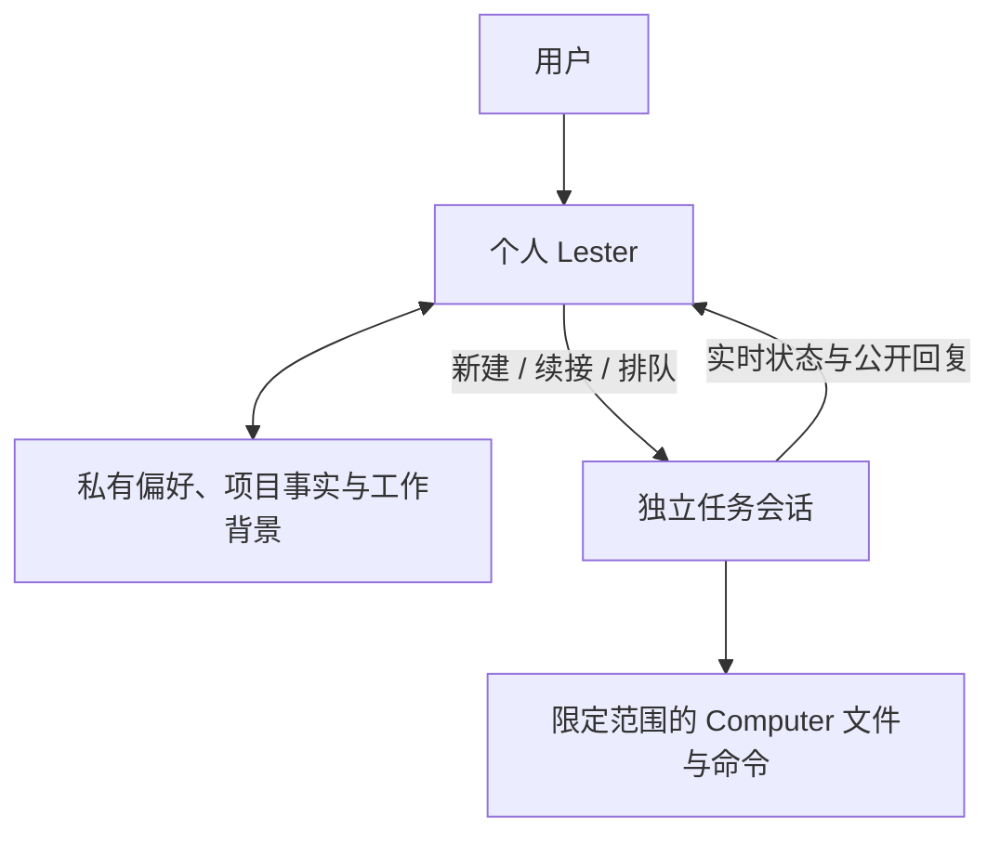

# 个人 Lester：记忆与工作安排

[文档目录](README.md) · [使用指南](usage.md) · [English](../personal-assistant.md)

固定的 **Lester** 入口（宽屏右下角、窄屏导航栏）在已登录的 `/app` 页面打开独立、常驻的个人助理，包括设置页面。面板由应用布局持有；切换页面或收起面板会保留对话、草稿和进行中的请求。宽屏使用非模态侧面板，给任务输入框保留操作空间；已打开的 Computer 面板沿用原有空间。窄屏使用适应可见视口的模态面板和原生焦点约束，手机上显示为完整抽屉；打开任务后会收起助理。`/app`、`/app/new` 和项目页面的输入框负责具体任务，已有 `/app/c/{id}` 会话仍使用原执行机制。模型与项目选择位于助理设置中。

个人助理没有 Computer，也没有文件、命令、浏览器、Skill、审批、停止或运行中补充工具。它使用已配置模型进行无工具、带 JSON Schema 的调用，服务端独立校验结果，只支持固定的记忆和工作安排操作。仅此类无工具调用，在 OpenAI 兼容服务明确以 HTTP 400/422 拒绝 `json_schema` 时，可协商一次 `json_object`，并在系统说明中保留完整 Schema。原有严格解析、依据与操作校验仍生效。认证、限流、无效 Schema、格式错误或结果未知的传输失败不会触发协商或重放；审批调用仍使用严格 JSON Schema。没有纯文本操作回退。具体工作继续使用现有 Agent 运行时、队列、项目规则和操作审批。

## 记忆行为

- **个人偏好：** 沟通、设计与工作习惯。
- **项目事实：** 只在选中项目后保存的决策与限制，不进入其他项目的任务。
- **工作背景：** 有意义的个人或项目意图。运行状态始终查询平台当前记录，不当作长期事实记忆。

记忆属于当前用户和工作区；选中项目不会把它变成共享项目知识。模型生成的每条事实必须引用最新用户消息中的原文，并指向来源个人对话。任务回复、检查过的历史和文件不会被自动提炼为记忆，升级时也不会导入已有任务全文。

稳定的主题和 ID 用于更正已有事实，主题比较不区分大小写。模型看到有界的主题目录和相关事实，不是全部对话。检索使用拉丁词语与汉字双字组合，并保留个人偏好和项目事实回退；每次最多附带 24 条、10,000 个事实字符。最近个人对话最多包含六轮完整回复，必要时继续按模型上下文限制裁剪，但保留最新用户输入。记忆明确存于 PostgreSQL，不使用向量库或服务商持有的记忆。

每个用户与工作区最多 128 条有效事实。空间已满会显示未保存记忆的提示，对话和工作安排仍可继续。忘记后可释放有效容量；删除标记保留，避免自动恢复已经忘记的主题，只有新的明确请求才能重新保存。

打开 **记忆** 可搜索、查看原始依据、编辑、忘记或撤销。自动提炼可以关闭，并会显示可撤销的回执。更正、忘记、撤销和自动提炼设置都会推进上下文边界与版本：之前的个人聊天仍可查看，但不再进入后续模型历史；记忆变更前已开始的旧模型回复会被拒绝，避免恢复已删除的事实。

忘记会移除有效记忆，原始聊天、撤销所需历史版本和已接受任务中的记忆快照仍保留，不代表从所有存储中抹除。撤销检查精确版本，不能覆盖更新的更正，也不能突破有效记忆容量。

## 新建与续接任务

可以直接说：**“在产品项目新建一个任务，整理评审清单。”** 也可以让 Lester 继续之前的会话。明确请求会进入普通任务委派链路，不必先打开任务输入框。欢迎页的快捷入口只向当前草稿添加建议，请核对后明确发送。

模型起初只看到有界、属于自己的任务元数据，包括项目名称、当前运行状态和未读回复信息。它可以进行一次只读标题或项目搜索、未读查询，或者检查一个已提供、属于自己的会话中有界的公开历史。不能遍历其他用户的工作，也不能查看工具内部信息和文件。目标不明确时会先澄清。

任务 ID 与提交 ID 在委派前持久保存。新任务使用 Lester 和 **默认权限**；已有会话保留原 Agent、模型和项目，正在运行时接收普通的有序下一任务队列消息。个人助理不能插入、停止、审批或提高已有任务的权限。

服务端只选择与当前任务相关的个人和同项目记忆，标注为参考资料后保存到已接受的任务输入中，普通项目规则快照仍生效。立即执行和排队共用的接收事务会再次检查会话是否仍属于准备时的项目，避免并发移动带走旧项目事实。之后更正或忘记记忆不会追溯修改已接受的任务。

待回答问题和待审批操作显示为需要你处理，并链接到原会话。任务卡通过已有工作区 SSE 更新项目与实时状态，公开回复只提供有界预览。完成表示 Agent 执行结束，不代表成果已获独立验证；文件、审批和执行详情仍在原任务查看。本功能不新增原生后台或锁屏推送。

## 未读回复

可以问：**“哪些会话有新回复，但我还没看？”** 也可以打开助理中的 **未读回复**。列表显示会话标题、项目和回复时间，查询当前工作区内属于自己的全部会话，不受最近任务数量限制；每页最多 30 个会话，并提供总数。加载更多和失败重试只读取列表，不会创建或重跑任务。模型的未读查询会遵守已经选定的项目范围。

未读指已保存、非空的公开 AI 回复超过当前确认的已读位置。工具调用、内部过程、未完成的流式输出和其他用户的会话不计入。任务状态与有无新回复相互独立：尚未结束的任务也可能已经产生公开回复。

打开助理、询问未读或展开回复预览不会标记任务已读。只有在前台聚焦的任务会话里看到已保存回复的末尾，才会确认已读位置；后台标签页和滚动区域外的回复仍保留未读。API 校验实际显示的消息，按用户、工作区、会话存储单调推进的位置，较旧确认不能隐藏更新的回复。记录可跨设备保留；打开的客户端在已读确认与现有工作区事件后重新读取，无需新增执行事件流或后台 Worker。

跟踪从迁移 036 开始。Lester 没有可信的旧已读历史，因此将已有回复作为升级基线，不推测之前哪些已经看过；基线之后新保存的回复参与未读跟踪。

## 持久化、恢复与 API

`personal_threads`、`personal_turns`、`personal_memories`、`personal_memory_changes`、`personal_delegations` 和 `conversation_read_states` 以 PostgreSQL 为准。独立会话级 advisory guard 串行处理个人消息，等待模型时不长期占用连接池连接。请求 UUID 与精确摘要防止重复模型调用。接受回复前按用户 → 登录会话 → 个人对话的锁顺序，再次检查账号、会话、成员权限及对话版本。

原处理者释放会话锁后，未完成请求变成已中断。响应丢失和委派结果不明时只查询原始运行或队列回执，不自动重调模型、重放工具、创建替代会话或增加后台 Worker。请求有时间限制，错误不包含服务商凭证，模型用量观察保存在个人对话中。

所有接口沿用普通登录与写操作 Origin 检查：

| 接口 | 行为 |
| --- | --- |
| `GET /api/v1/personal?before={seq}` | 最多 30 条按时间排列的个人对话、记忆、当前任务与首屏未读 |
| `POST /api/v1/personal/messages` | `{id, content, model_id, project_id}`，接受一条有作用域的持久消息 |
| `GET /api/v1/personal/messages/{id}` | 查询原对话或回执，恢复不会重新委派 |
| `GET /api/v1/personal/tasks` | 有界任务卡与首屏未读 |
| `GET /api/v1/personal/unread?cursor={cursor}&project_id={id}` | 只读未读会话、总数和下一页游标，可选项目范围 |
| `POST /api/v1/conversations/{id}/read` | `{message_id}`，校验本人会话的公开回复，单调推进已读位置 |
| `PATCH /api/v1/personal/settings` | `{auto_memory}` |
| `PATCH /api/v1/personal/memories/{id}` | `{revision, content, forget}` |
| `POST /api/v1/personal/changes/{id}/undo` | 校验版本、幂等撤销 |

个人草稿和待确认回执 ID 沿用按账号隔离的浏览器草稿存储。收起与重开保留文字，并只读刷新已保存对话与记忆，首次读取失败后也可恢复；不会因重开而重新发送消息或委派。记忆搜索区分没有匹配结果，矮屏编辑区可滚动，不被固定操作栏挤压。退出登录清理草稿并阻止旧回调写入。iOS/Android 原生主页仍打开任务输入框，个人助理使用应用内相同的 Web 入口，不增加另一套原生记忆或运行时。

## 升级与验证

先备份并停止 API 写入和活跃任务，按编号执行尚未完成的迁移至 `000036_conversation_reads.up.sql`，再一起重建 API 与 Web。全新 Compose 数据库初始化 001–036；Helm 需在部署前从外部执行 SQL。不要删除数据卷或替换加密密钥。036 建立已读跟踪与已有回复基线，回滚只移除已读位置和辅助索引，保留会话、消息、任务和记忆。回滚 031 会删除个人对话、记忆和委派记录，保留任务会话、文件和外部操作效果。

PostgreSQL 测试覆盖记忆依据、更正、撤销、删除边界、容量、用户和项目隔离、撤权、异常处理者、幂等、真实任务与队列接收、未读分页、已读位置校验和回滚。两连接测试池用于发现嵌套接收导致的连接饥饿。生产浏览器测试使用桌面和移动端固定接口夹具，覆盖对话、草稿、丢失响应、记忆管理、任务卡、矮屏和六语言帮助；这些不等于真实模型服务或原生设备验证。
